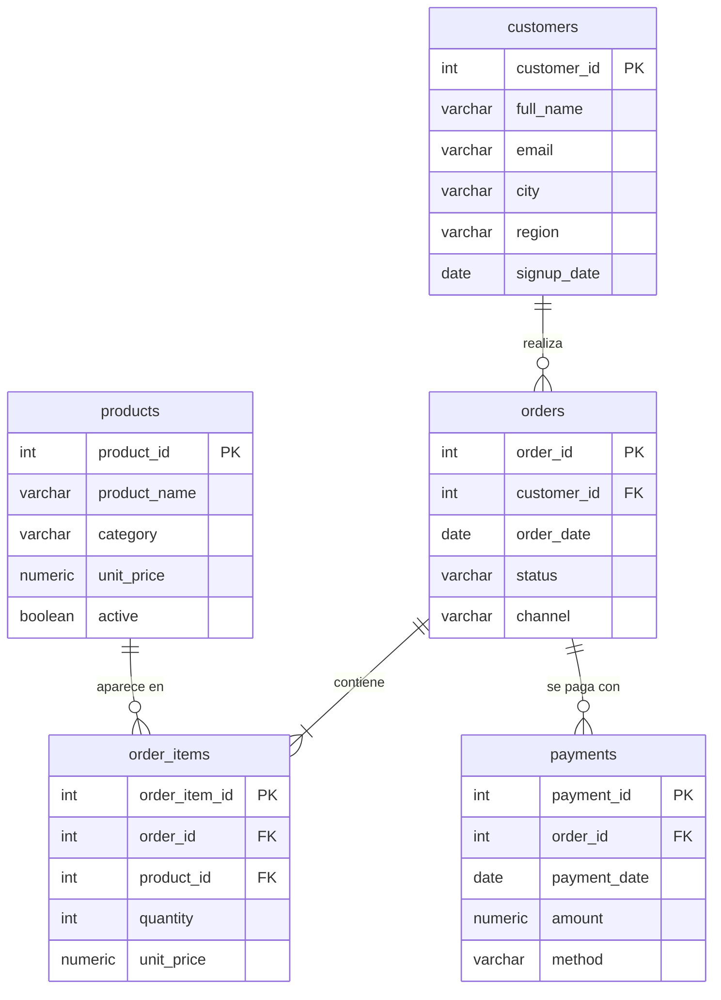

# Caso de análisis SQL: indicadores de un e-commerce

> **English summary.** A small PostgreSQL case study: a five-table e-commerce schema (customers, products, orders, order items, payments), hand-written sample data and eleven analytical queries covering sales, rankings with window functions, moving averages, active customers, cancellation rate, low-selling products and payment reconciliation. The dataset is tiny and synthetic on purpose; the goal is to show query technique, not business findings.

Once consultas analíticas en PostgreSQL sobre el modelo de datos de una tienda online: ventas, clientes, productos, canales y conciliación de pagos.

## Resultado principal

**Las 11 consultas se ejecutan sin errores en PostgreSQL 16 y sus resultados están verificados uno a uno** contra los datos de muestra. Por ejemplo, la conciliación de pagos confirma que los 6 pedidos completados cuadran con lo pagado (318.870 en total) y que el pedido cancelado no tiene pagos.



### Consultas y resultados

Resultados obtenidos al ejecutar los tres archivos en PostgreSQL 16 sobre una base vacía. Los montos están en pesos chilenos.

| # | Consulta | Técnica | Resultado con los datos de muestra |
|---|---|---|---|
| 1 | Ventas totales y pedidos completados | `JOIN`, agregación | 318.870 en 6 pedidos |
| 2 | Ventas por categoría | `GROUP BY` | Electrónica 151.950 · Calzado 109.980 · Ropa 49.950 · Accesorios 6.990 |
| 3 | Ranking de clientes por ventas | CTE, `RANK()` | 1.º María López (100.980), 2.º Juan Pérez (94.960) |
| 4 | Ventas mensuales con promedio móvil | `DATE_TRUNC`, ventana con `ROWS` | Abril 94.960 · Junio 82.950 · Julio 140.960 |
| 5 | Clientes activos en los últimos 90 días | CTE de parámetros, filtro por fecha | 4 de 5 clientes |
| 6 | Ticket promedio por pedido | Subconsulta | 53.145 |
| 7 | Ventas por canal | `GROUP BY` | web 170.920 · app 94.970 · store 52.980 |
| 8 | Tasa de cancelación | Agregación condicional | 14,3 % (1 de 7 pedidos) |
| 9 | Productos con pocas ventas | `LEFT JOIN`, `FILTER`, `COALESCE` | 4 productos con menos de 3 unidades; Mouse Gamer con 0 |
| 10 | Conciliación de pagos por pedido | Dos CTE, `LEFT JOIN` | Los 6 pedidos completados cuadran (diferencia 0); el cancelado no tiene pagos |
| 11 | Monto pagado por método | Ventana sobre agregado | Tarjeta de crédito 73,4 % · débito 17,2 % · efectivo 9,4 % |

### Supuestos

- **Venta** significa pedido con estado `completed`; los cancelados se excluyen de todos los indicadores de venta.
- **Fecha de referencia.** "Clientes activos" usa una fecha fija, `2023-07-31`, declarada al inicio de la consulta. Los datos terminan en julio de 2023, por lo que con la fecha actual la consulta no devolvería filas.
- **Umbral de pocas ventas.** Menos de 3 unidades. Es un valor de ejemplo ajustado al tamaño de los datos.

## Dataset

- **Fuente:** datos sintéticos escritos a mano para este caso (`sql/sample_data.sql`); no provienen de una empresa real.
- **Tamaño:** 5 clientes, 6 productos, 7 pedidos (1 cancelado), 10 líneas de pedido y 6 pagos, de abril a julio de 2023. Montos en pesos chilenos.

## Cómo reproducirlo

```bash
createdb sql_case
psql sql_case -f sql/schema.sql -f sql/sample_data.sql
psql sql_case -f sql/query_analysis.sql
```

## Estructura

```
sql/
  schema.sql            esquema de 5 tablas con claves primarias y foráneas
  sample_data.sql       datos de muestra y ajuste de secuencias
  query_analysis.sql    las 11 consultas
```

## Limitaciones y próximos pasos

- Los datos son sintéticos y mínimos: sirven para comprobar que las consultas son correctas, no para sacar conclusiones de negocio.
- El promedio móvil de la consulta 4 promedia los tres últimos meses **con ventas**, no tres meses de calendario: mayo no tiene pedidos y no aparece. Para un promedio de calendario habría que generar la serie de meses con `generate_series`.
- No hay pruebas automatizadas; la verificación fue manual.
- Próximos pasos: generar datos sintéticos de mayor volumen y agregar pruebas automáticas que comparen cada consulta con su resultado esperado.

## Stack

PostgreSQL 16 (usa `FILTER`, funciones de ventana y `DATE_TRUNC`).
